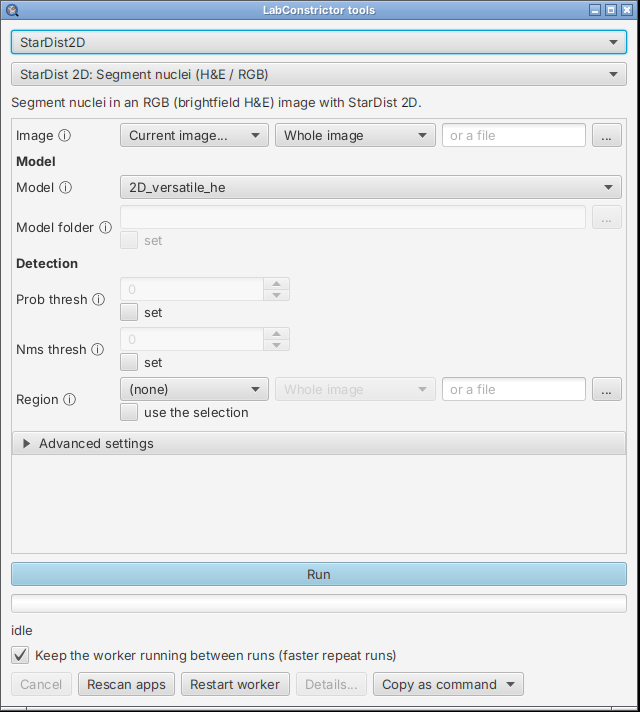

# LabConstrictor for QuPath

Run the analysis tools of your LabConstrictor apps from inside [QuPath](https://qupath.github.io). Open **Extensions > LabConstrictor tools...**, pick an app and a tool, and press **Run** on the image that is open. Outlines and points come back as QuPath annotations on your image; tables, values and result images open in a results window. The analysis runs in the app's own Python environment, so QuPath needs no Python setup.


*The StarDist2D app's "Segment nuclei (H&E / RGB)" tool, run from QuPath: the nuclei it found are annotations on the open image.*

> **Experimental.** This is an alpha pre-release (`v0.1.0-alpha.7`) for **QuPath 0.7** (built and tested with QuPath 0.7.0). It has been tested on Linux, Windows and macOS, but expect bugs and changes. Please [tell us](https://github.com/CellMigrationLab/LabConstrictor-QuPath/issues) what you find.

## Install

1. **Install a LabConstrictor app** from the [App Centre](https://cellmigrationlab.github.io/LabConstrictor-Site/apps/?host=qupath). Its installer registers the app on your computer, which is how the extension finds it.
2. **Download** [`labconstrictor-qupath-v0.1.0-alpha.7.jar`](https://github.com/CellMigrationLab/LabConstrictor-QuPath/releases/download/v0.1.0-alpha.7/labconstrictor-qupath-v0.1.0-alpha.7.jar) (newer versions appear on the [Releases page](https://github.com/CellMigrationLab/LabConstrictor-QuPath/releases)).
3. **Drag the file onto the QuPath window** (or copy it into the extensions folder shown in QuPath's Preferences).
4. **Restart QuPath.**

## First use



1. Open an image in QuPath.
2. Choose **Extensions > LabConstrictor tools...**
3. Pick an app, then a tool. The form shows that tool's settings; hover over an **ⓘ** to read what a setting means.
4. For a large image, choose the **Image area** to send: the whole image, the selected annotations, or what the viewer shows.
5. Press **Run**. A progress bar and a **Cancel** button are there while the tool runs. Outlines and points appear on your image as annotations; everything else opens in a results window.

<br clear="right">

The step-by-step guide, with troubleshooting, is on the website: [Install the QuPath extension](https://cellmigrationlab.github.io/LabConstrictor-Site/guides/qupath/).

## Apps that work in QuPath

| App | What it does |
|---|---|
| [StarDist2D](https://cellmigrationlab.github.io/LabConstrictor-Site/apps/stardist2d/) | Segment nuclei and cells in 2D images with StarDist |
| [NucleiSky](https://cellmigrationlab.github.io/LabConstrictor-Site/apps/nucleisky/) | Align microscopy images by matching the pattern of their nuclei |
| [Guess the Condition](https://cellmigrationlab.github.io/LabConstrictor-Site/apps/guessthecondition/) | A blinded test of whether conditions can be told apart by eye |
| [Playground](https://cellmigrationlab.github.io/LabConstrictor-Site/apps/labconstrictor-playground/) | Check your computer and try every feature of the extension |

Any LabConstrictor app that declares QuPath as one of its hosts appears in the window; no extra extension is needed per app. The [App Centre](https://cellmigrationlab.github.io/LabConstrictor-Site/apps/?host=qupath) has the current list.

## Getting help

- **No menu entry?** The extension needs QuPath 0.7 (**Help > About** shows your version). Restart QuPath after adding the jar.
- **No app to choose?** Install a LabConstrictor app, then press **Rescan apps**.
- **A run failed?** The status line says what went wrong, and **Details...** shows the full report.
- **Guides:** the [LabConstrictor website](https://cellmigrationlab.github.io/LabConstrictor-Site/) and its [guides](https://cellmigrationlab.github.io/LabConstrictor-Site/guides/).
- **Bugs and questions:** the [issue tracker](https://github.com/CellMigrationLab/LabConstrictor-QuPath/issues).

## More detail

- [Technical reference](docs/REFERENCE.md): every rule the extension follows (large images and the Image area, pixel size, channels, annotations, number limits), what is not done yet, and the script-only install without the jar.
- The same apps also run in [napari](https://github.com/CellMigrationLab/LabConstrictor-napari) and [Fiji](https://github.com/CellMigrationLab/LabConstrictor-Fiji). To make your own app, start at the [LabConstrictor website](https://cellmigrationlab.github.io/LabConstrictor-Site/).

## For developers

Build the jar with JDK 25 (QuPath 0.7 is built with Java 25), then run a GUI test on a virtual screen (Linux):

```bash
QUPATH=/path/to/QuPath JAVA_HOME=/path/to/jdk-25 ./build.sh
tests/ci_setup_apps.sh /tmp/lc main                                   # test apps and a private registry
QUPATH=/path/to/QuPath LC_HOME=/tmp/lc/home tests/run_gui_ci.sh       # every GUI test
```

The GUI tests change the QuPath installation they are pointed at, so use a disposable copy. What each test covers, and the lint: [technical reference](docs/REFERENCE.md#build-from-source-and-test).
