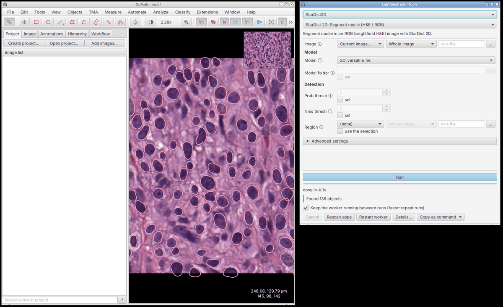

# LabConstrictor for QuPath

Run the analysis tools of your LabConstrictor apps from inside [QuPath](https://qupath.github.io). One window lists every installed app: pick an app and a tool, and run it on the image that is open. Outlines and points come back as QuPath annotations on your image; tables, values and result images open in a results window. The analysis runs in the app's own Python environment, so QuPath needs no Python setup.

*The StarDist2D app's "Segment nuclei (H&E / RGB)" tool, run from QuPath: the nuclei it found are annotations on the open image.*

## Install

Needs QuPath 0.7. Drag the jar from the [Releases page](https://github.com/CellMigrationLab/LabConstrictor-QuPath/releases) onto QuPath and restart it. Every step, and what to do when something goes wrong: [QuPath guide](https://cellmigrationlab.github.io/LabConstrictor-Site/guides/qupath/).

Any LabConstrictor app that declares QuPath as a host appears in the window. The [App Centre](https://cellmigrationlab.github.io/LabConstrictor-Site/apps/?host=qupath) lists them.

## More

- [QuPath extension reference](docs/REFERENCE.md): how the extension behaves rule by rule, and how to build and test it.
- Bugs and questions: the [issue tracker](https://github.com/CellMigrationLab/LabConstrictor-QuPath/issues).
- The same apps also run in [napari](https://github.com/CellMigrationLab/LabConstrictor-napari) and [Fiji](https://github.com/CellMigrationLab/LabConstrictor-Fiji). To make your own app, start at the [LabConstrictor website](https://cellmigrationlab.github.io/LabConstrictor-Site/).
