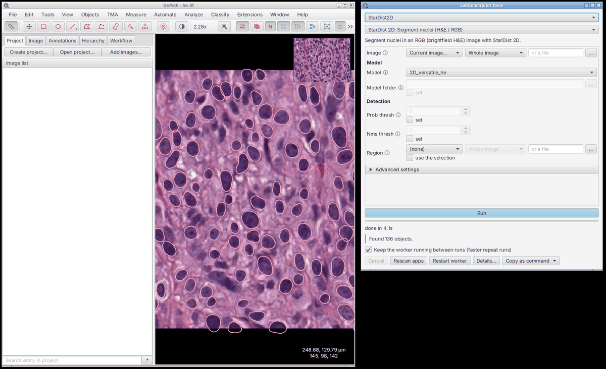
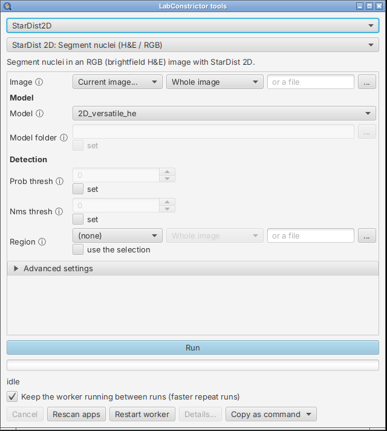

# Install the QuPath extension

Run the tools of your LabConstrictor apps from QuPath: one window lists every installed app, you pick a tool and press Run, and outlines and points come back as annotations on your image.

## What you need

- [QuPath](https://qupath.github.io) 0.7. Older QuPath versions are not supported.
- At least one LabConstrictor app that works in QuPath. The [App Centre](https://cellmigrationlab.github.io/LabConstrictor-Site/apps/?host=qupath) lists them. Installing the app and installing this extension are two separate steps: the app's installer registers the app on your computer, which is how the extension finds it.
- Nothing else: you do not need Java or Python of your own.

## Install

1. **Download the extension.** The current version is `v0.1.0-alpha.7`: [download `labconstrictor-qupath-v0.1.0-alpha.7.jar`](https://github.com/CellMigrationLab/LabConstrictor-QuPath/releases/download/v0.1.0-alpha.7/labconstrictor-qupath-v0.1.0-alpha.7.jar). A newer version, when there is one, is at the top of the [Releases page](https://github.com/CellMigrationLab/LabConstrictor-QuPath/releases).
2. **Add it to QuPath.** Drag the file onto the QuPath window, or copy it into the extensions folder shown in QuPath's Preferences.
3. **Restart QuPath.** Close QuPath and start it again.

> [!TIP]
> **Without the jar.** Download the single file `LabConstrictorTools-all.groovy` from the same release, open it in QuPath's Script Editor and run it. You need it only if you cannot install the jar: with the jar installed, use the menu entry.

## Open it

1. Open an image in QuPath.
2. Choose **Extensions > LabConstrictor tools...**
3. Pick an app, then a tool. The form shows the tool's settings; hover over an **ⓘ** to read what a setting means.
4. Press **Run**.

> [!TIP]
> **Good to know.**
>
> - An image input can be the image open in QuPath, another image of the open project, or a file.
> - For a large image, choose the **Image area** to send: the whole image, the selected annotations, or what the viewer shows. Results come back on the right place of the slide. An area of more than 100 million pixels is refused with a message, never shrunk silently: choose a smaller area.
> - Outlines and points found in the open image become annotations, named and classified after the app and the result (for example `StarDist2D:stardist_outlines`). When a tool finds more than 50 outlines they get no names, so that the names do not hide the image.
> - When you run a tool again, it replaces only the annotations it drew itself. Your own annotations are never removed.
> - Tables, values, messages and result images open in a results window. A result image has an **Open in QuPath** button.
> - The files a tool writes go to a folder under `~/.labconstrictor/results`. Only the newest 20 result folders are kept, older ones are deleted automatically: copy a result you want to keep to a folder of your own.
> - A progress bar and a **Cancel** button are there while a tool runs.
> - A pixel-size setting is filled in from the image when the image says its pixel size. If it does not, the field stays empty and you type the value.
> - A number outside the allowed range is refused with a message such as `'Threshold' must be <= 10`. It is never changed to fit.
> - If you install another app while QuPath is open, press **Rescan apps**.

## Check that it worked

1. Install the [Playground](https://cellmigrationlab.github.io/LabConstrictor-Site/apps/labconstrictor-playground/) app.
2. In QuPath, choose **Extensions > LabConstrictor tools...** If the window was already open, press **Rescan apps**.
3. Pick **LabConstrictor Playground**, then its **Feature tour** tool. Do not choose an image: the tool makes its own small demo image.
4. Press **Run**.

You should get the message "Found 16 blob(s)" and a results window with a label image and tables.

## If something does not work

- **No menu entry.** The extension needs QuPath 0.7 (**Help > About** shows your version). Check that the jar is in the extensions folder and restart QuPath.
- **"No LabConstrictor app is registered on this machine".** Install a LabConstrictor app, then press **Rescan apps**.
- **An app is missing from the list.** Press **Rescan apps**: the list of skipped apps says why. The app may not offer its tools in QuPath, it may have been installed with an old installer (install its newest version), or it may need a newer version of this extension (the message names the version to get).
- **A run fails.** The status line says what failed; **Details...** shows the full report. The log file is `~/.labconstrictor/logs/labconstrictor.log`.
- **You opened another image while a tool was running.** The results are not drawn on the new image; the status line says where the result files are.
- **You wonder where results are kept.** In `~/.labconstrictor/results` and `~/.labconstrictor/runs`. The newest 20 results and 50 run records are kept; older folders that LabConstrictor made are removed automatically.
- **You want to know which apps are found.** [Check an installed app](https://cellmigrationlab.github.io/LabConstrictor-Site/guides/tools-install/) shows the commands that list the registered apps and say what is wrong with one.
- **You want to report a bug.** Open an [issue](https://github.com/CellMigrationLab/LabConstrictor-QuPath/issues) with what you ran and what you saw.

How the extension works, rule by rule: [QuPath extension reference](https://cellmigrationlab.github.io/LabConstrictor-Site/guides/qupath-reference/). Source code and issues: [LabConstrictor-QuPath](https://github.com/CellMigrationLab/LabConstrictor-QuPath).
